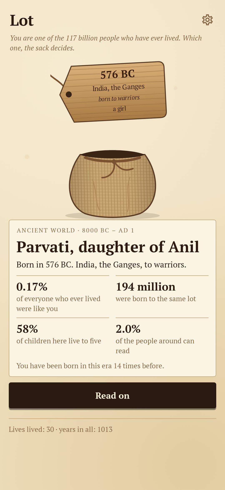
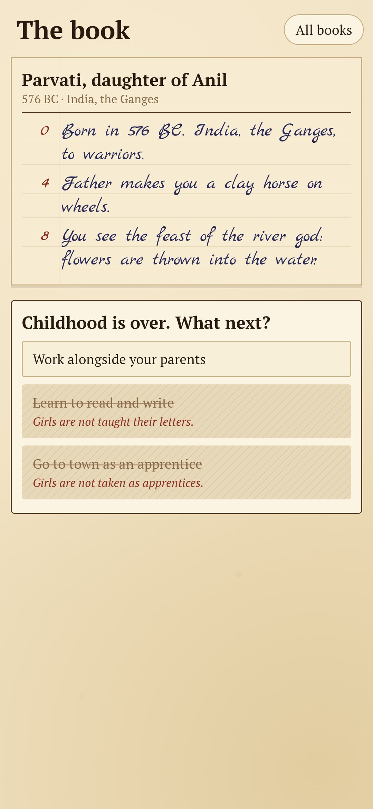
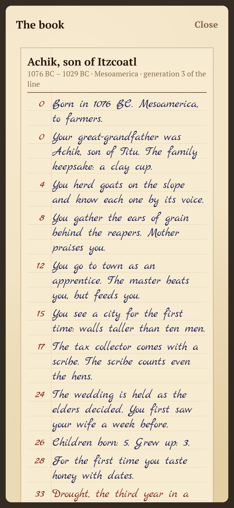
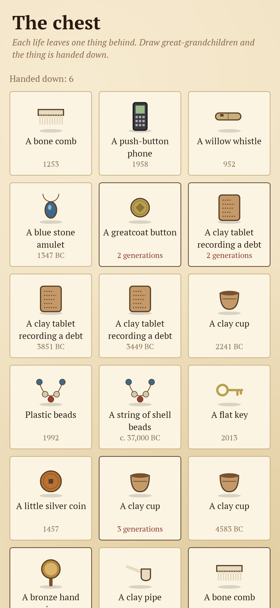
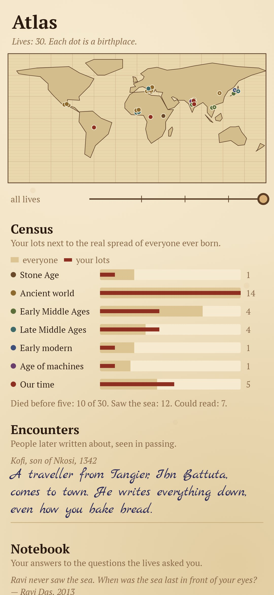

<div align="center">


# Lot

### You are one of 117 billion. The sack decides which.

*About 117 billion people have ever been born. Lot draws you one of them, fairly, weighted by era, place and station. So you are most often a peasant long before 1800, and nearly half of the time you don't live to five. The life is written into a parish register, a page at a time. At each fork you see every door, including the shut ones and why they are shut. Each life leaves one thing in the chest, and a great-grandchild can inherit it. Free, no ads, no account, no internet.*

[](https://github.com/bigdevwhale/lot/actions/workflows/android.yml)


[](LICENSE)

**English** · [Русский](README.ru.md) · [Changelog](CHANGELOG.md)

    

</div>

---

## How it works

1. **Draw a lot.** Shake the sack and a wooden tag rises out of it with the year, the place, the family and boy or girl burnt into it. The odds come with it: how many of everyone who ever lived were born like you, how many children here live to five, and how many people around you can read.
2. **Read the book.** The life is written into a parish register in the registrar's hand. Each page turned is a few years: childhood, work, a match, hard times, old age, death. There are about 200 everyday lines across six ages.
3. **History from the side.** About 70 real events reach a life as rumours and consequences: the Black Death, the Mongols, the silk caravans, the Partition, the first satellite crawling across the sky. Rarely you pass someone later written about: Socrates arguing in the square, Ibn Battuta writing down how you bake bread.
4. **Doors.** At each fork every door is shown, but some are shut, and it says why: *Girls are not taught their letters. You are not free to leave. The elders have already agreed.* Inequality, without a lecture.
5. **Witness mode.** Let fate choose at every fork, and only read.
6. **The chest.** Each life leaves one thing: a bone needle, a clay tablet recording a debt, a greatcoat button, a push-button phone.
7. **Great-grandchildren.** After a life with children, draw a great-grandchild's lot, born 70–94 years later in the same place. They inherit the surname, the family's means and the same thing. The thing gathers its holders, generation after generation.
8. **A question for you.** At the end a life asks one quiet question about you today, such as *This person never saw the sea. When was the sea last in front of your eyes?* The answers gather in a notebook.
9. **Atlas and census.** Your birthplaces are pinned on an old map with a slider through time. Your lots stand next to the real spread of everyone ever born. The atlas also lists the people you met.

Every life is replayed from its seed and your choices, so every book in the archive can be read again in full.

## Build

```
./gradlew testDebugUnitTest assembleDebug
./gradlew -Pdemo assembleDebug          # app.lot.demo with thirty lives already lived
./gradlew testDebugUnitTest -Prender --tests '*RenderArt*'   # the sack, the things, the map and every screen to app/build/art
python tools/shots.py app/build/art     # README screenshots from the renders
```

The engine is `domain/Life.kt`, the eras, regions and families are in `domain/World.kt`, and the lines and history are `app/src/main/assets/lines.tsv` and `history.tsv`. Everything is drawn in code: the sack and tag in `ui/art/Sack.kt`, the things in `ui/art/ThingArt.kt`, the map in `ui/art/MapArt.kt`. The birth weights follow the Population Reference Bureau's estimate of how many people have ever lived.

Fonts: [PT Serif](https://fonts.google.com/specimen/PT+Serif) and [Marck Script](https://fonts.google.com/specimen/Marck+Script), SIL Open Font License.
