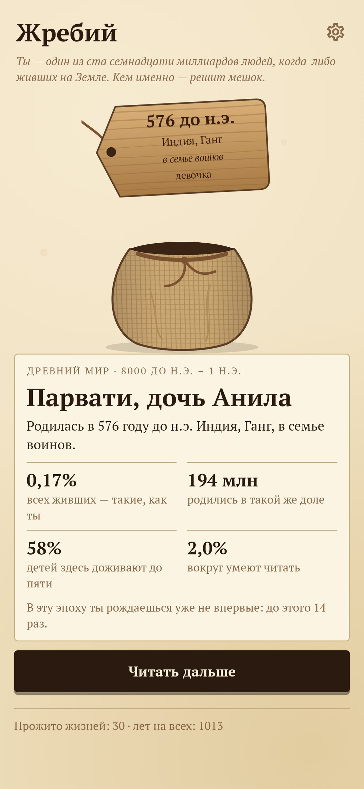
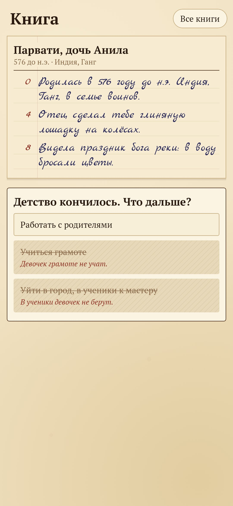
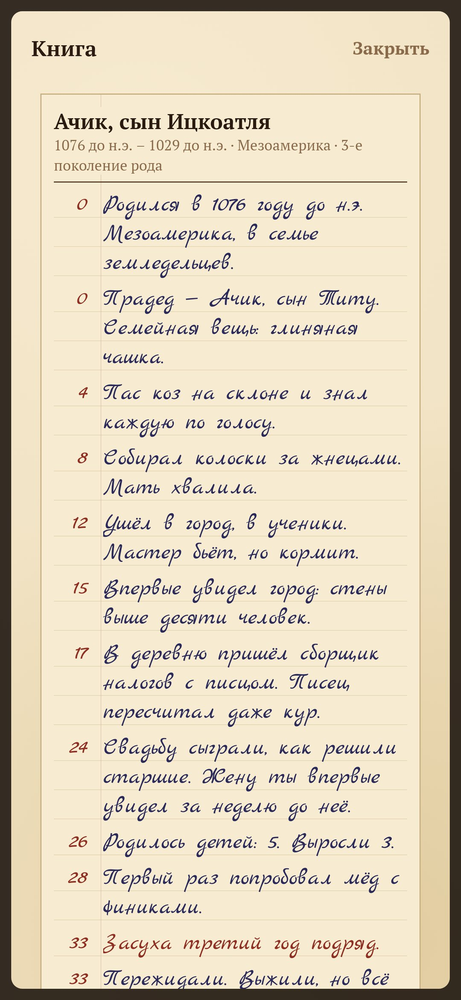
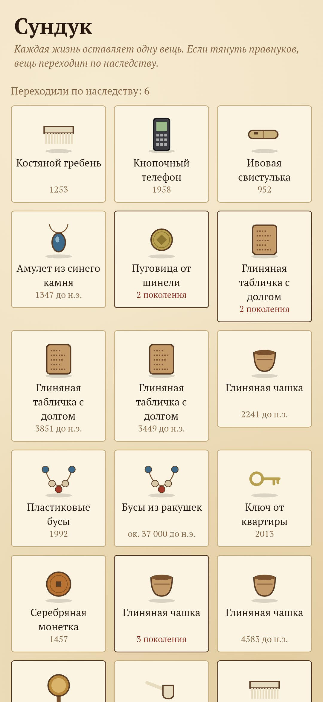
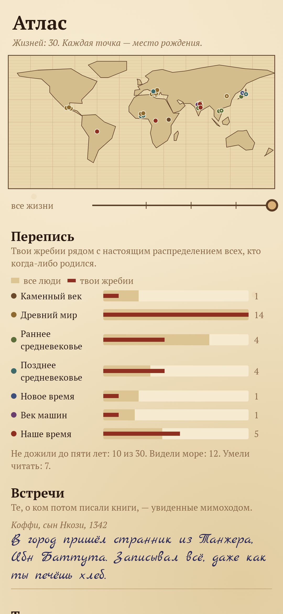

# Жребий

### Ты — один из ста семнадцати миллиардов. Кем именно — решит мешок.

*За всю историю на Земле родилось около 117 миллиардов человек. «Жребий» честно вытягивает тебе одного из них, с весами эпох, мест и сословий. Поэтому чаще всего ты крестьянин задолго до 1800 года, и почти в половине случаев не доживаешь до пяти лет. Жизнь записывается в метрическую книгу страница за страницей. На развилках видны все двери, и закрытые тоже, с объяснением, почему закрыты. Каждая жизнь оставляет вещь в сундуке, а правнук может её унаследовать. Бесплатно, без рекламы, без аккаунта, без интернета.*

[English](README.md) · **Русский** · [Изменения](CHANGELOG.md)

    

---

## Как это устроено

1. **Жребий.** Тряхнёшь мешок, и из него поднимается деревянная бирка. На ней выжжены год, место, семья и кто ты: мальчик или девочка. Рядом шансы: какая доля всех живших родилась такими же, сколько детей здесь доживают до пяти и сколько людей вокруг умеют читать.
2. **Книга.** Жизнь записывается в метрическую книгу почерком писаря. Каждое «дальше» — несколько лет: детство, работа, сватовство, беды, старость, смерть. Около 200 бытовых строк на шесть эпох.
3. **История сбоку.** Около 70 настоящих событий доходят до жизни слухами и последствиями: «чёрная смерть», монголы, шёлковые караваны, раздел Индии, первый спутник в небе. Изредка мимо проходит тот, о ком потом писали книги: Сократ спорит на площади, Ибн Баттута записывает, как ты печёшь хлеб.
4. **Двери.** На развилке видны все двери, но часть закрыта, и написано почему: «Девочек грамоте не учат», «Ты не свободен уйти», «Старшие уже сговорились». Неравенство без нотаций.
5. **Свидетель.** Можно отдать все выборы судьбе и только читать.
6. **Сундук.** Каждая жизнь оставляет одну вещь: костяную иглу, глиняную табличку с долгом, пуговицу от шинели, кнопочный телефон.
7. **Правнуки.** После жизни с детьми можно вытянуть жребий правнука: он родится через 70–94 года на том же месте. Ему достаются фамилия, достаток семьи и та же вещь. На вещи из поколения в поколение копятся её владельцы.
8. **Вопрос тебе.** В конце жизнь задаёт один тихий вопрос про тебя сегодняшнего, например: «Этот человек так и не увидел моря. Когда море в последний раз было у тебя перед глазами?» Ответы складываются в тетрадку.
9. **Атлас и перепись.** Места рождений отмечены на старой карте, по которой можно идти ползунком во времени. Твои жребии стоят рядом с настоящим распределением всех людей. Там же список встреч.

Каждая жизнь воспроизводится из зерна и твоих выборов, поэтому любую книгу из архива можно перечитать целиком.

Сборка — в [README.md](README.md#build).
